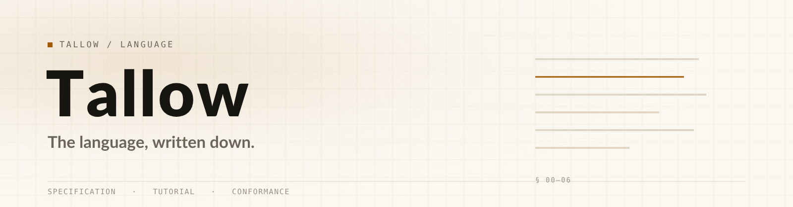
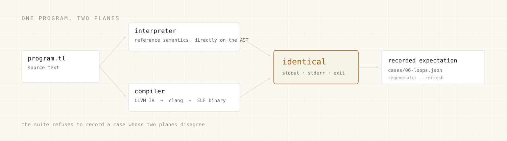

<div align="center">

<picture>
  <source media="(prefers-color-scheme: dark)" srcset="assets/lang-hero-dark.png">
  <source media="(prefers-color-scheme: light)" srcset="assets/lang-hero-light.png">
  
</picture>

**A specification you can implement against, a tutorial you can finish in an evening, and a conformance suite that decides who is right.**

<sub><a href="#learn-it">Learn it</a> &nbsp;·&nbsp; <a href="#read-it">Read the spec</a> &nbsp;·&nbsp; <a href="#verify-an-implementation">Verify an engine</a> &nbsp;·&nbsp; <a href="#install">Install</a> &nbsp;·&nbsp; <a href="#what-is-in-here">Repository map</a></sub>


[](https://github.com/aamirmanisa/Tallow-Language/actions/workflows/spec-freshness.yml)

</div>

---

Tallow is a statically typed language for writing scrapers, extraction pipelines and browser automation — with the network, browser and extraction primitives in the standard library instead of in a framework, and a native binary at the end instead of a runtime.

This repository is the **language itself**: what it means, how to learn it, and how to prove an implementation is correct. The compiler and runtime live one repository over, at [tallowsphere](https://github.com/aamirmanisa/tallowsphere).

## Three ways in

The repository has three readers, and each one starts somewhere different.

| Door | You get | Start |
|---|---|---|
| **Learn it** | Six short chapters, every program runnable. An evening, not a weekend. | [`tutorial/`](tutorial/) |
| **Read it** | A normative specification in reading order — lexical form through to the standard library's declared surface. | [`spec/00-preface.md`](spec/00-preface.md) |
| **Verify it** | `.tl` programs paired with recorded expectations, run against both execution planes. | [`conformance/`](conformance/) |

None of the three is decorative: each chapter's program is executed by CI, each generated spec section is reproduced from a pinned engine commit, and every conformance case must pass on the interpreter *and* the compiler.

## Install

```console
$ curl -fsSL https://raw.githubusercontent.com/aamirmanisa/Tallow-Language/main/install/install.sh | sh
$ tallow --version
```

The installer resolves the newest published release of [tallowsphere](https://github.com/aamirmanisa/tallowsphere/releases), verifies its sha256, and installs **both** `tallow` and `libtallow.a` — the compiler alone cannot link the programs it builds.

**Platform truth:** linux-aarch64 is the only platform with a published build today. On anything else the installer names the asset it looked for and exits rather than installing something unverified; build from source in the meantime, which needs Rust 1.98.1, `clang` and a C/C++ toolchain.

`clang` is required at run time, not just build time: Tallow emits IR and asks `clang` to link it.

---

## The language in sixty seconds

```tallow
fn main() {
    let page = browser.open("https://example.com")
    print(page.title)
}
```

```tallow
// values carry their type; the checker runs before anything executes
let count = 3                     // i64
let label = "items"               // str
let ratio = 0.5                   // f64
let flag = true                   // bool

// a function that can fail says so in its type
fn parse_positive(n: i64) -> Result<i64> {
    if n <= 0 {
        bail "not positive"
    }
    Ok(n)
}

// match is how a caller decides — and it must decide
fn main() {
    let doubled = parse_positive(21) match {
        Ok(x) -> x * 2
        Err(e) -> 0
    }
    print(doubled)               // 42
    print(parse_positive(0))     // Err("not positive")
}
```

Three ideas carry the rest of the language:

**Two planes, one meaning.** Every program can be interpreted or compiled. The specification defines behaviour once; the conformance suite requires both planes to produce it.

**Errors are values.** `Result` is a type, `match` is exhaustive, and a discarded `Result` is a diagnostic rather than a shrug.

**The standard library is the framework.** `browser`, `http`, `db`, `fs`, `json`, `csv` are modules of the language, not packages you assemble.

<picture>
  <source media="(prefers-color-scheme: dark)" srcset="assets/lang-planes-dark.png">
  <source media="(prefers-color-scheme: light)" srcset="assets/lang-planes-light.png">
  
</picture>

## Learn it

Six chapters, each one runnable, each one short:

| Chapter | What it settles |
|---|---|
| [01 · Hello](tutorial/01-hello.md) | A program, a build, an exit code |
| [02 · Values](tutorial/02-values.md) | Types, literals, operators, strings |
| [03 · Control](tutorial/03-control.md) | `if`, `while`, `for`, `match` |
| [04 · Functions](tutorial/04-functions.md) | Signatures, returns, recursion, closures |
| [05 · Results](tutorial/05-results.md) | `Result`, `Option`, exhaustive matching |
| [06 · Scripts](tutorial/06-scripts.md) | Shebangs, arguments, exit codes |

Every chapter's program is a standalone file under [`tutorial/programs/`](tutorial/programs/), and "each chapter runs" is checked rather than claimed:

```console
$ ./tutorial/run-all.sh /path/to/tallow
ok   tutorial/programs/01-hello.tl
…
10 program(s), 0 failure(s)
```

[measured 2026-10-26 · `tallow 1.5.8` · tutorial, example and script programs: 10 run, 0 failures, both planes identical]

## Read it

The specification is normative, in reading order:

| | |
|---|---|
| [00 · Preface](spec/00-preface.md) | What the document is, and what "MUST" means here |
| [01 · Lexical](spec/01-lexical.md) | Source form, tokens, comments, literals |
| [02 · Grammar](spec/02-grammar.md) | The grammar, production by production |
| [03 · Types](spec/03-types.md) | Type system, inference, optionals, results |
| [04 · Semantics](spec/04-semantics.md) | Evaluation order, scoping, mutation |
| [05 · Errors](spec/05-errors.md) | The error model and the code catalogue |
| [06 · Standard library](spec/06-stdlib.md) | Declared surface and contracts |

The error catalogue is enumerated, not illustrative: **176 distinct `E…` codes** [measured 2026-10-26, regenerated at `a8921c3`]. A diagnostic you cannot look up is a diagnostic you cannot fix.

Most of `06-stdlib.md` is generated from the engine at a pinned commit — `spec/generated.json` records the sha and the date. `tools/check_drift.py` fails when regenerating against engine `main` changes the content, so prose and surface counts cannot drift apart quietly.

## Verify an implementation

The conformance suite is the arbiter:

```console
$ python3 conformance/run.py --tallow /path/to/tallow
0 failure(s), 20 case(s) run, 2 skipped
```

[measured 2026-10-26 · engine `main` at `a8921c3` · the two skipped cases exercise the opt-in `zk` and `fhe` surfaces; `--features zk,fhe` runs them]

Every case in `conformance/cases/` is a `.tl` program paired with the exact stdout and exit status the reference engine produced:

```text
cases/06-loops.tl        the program
cases/06-loops.json      stdout, stderr, exit code — recorded, not written by hand
```

Expectations are regenerated from the engine:

```console
$ python3 conformance/run.py --tallow /path/to/tallow --refresh
```

`--refresh` **refuses** to record a case whose two planes disagree. That single rule is what keeps the suite honest: a case can only encode behaviour the interpreter and the compiler both produce, so it can never become a test of "what the compiler happens to do".

Behaviour that the suite does not cover is not part of the language yet — that is the standard this repository holds itself to, and it is why the suite is small and growing rather than large and stale.

## What is in here

```text
assets/         hero and diagram sources (SVG) plus the rendered PNGs
spec/           the normative specification, in reading order
tutorial/       six chapters plus tutorial/programs/ — every one runnable
examples/       complete programs (fizzbuzz, optionals, enums, scripts/wc.tl, scripts/todo.tl)
conformance/    cases/ (22 programs + recorded expectations), findings/, run.py
install/        install.sh and packaging notes
tools/          generate.py — regenerates generated spec sections from the engine
```

### Registered findings

`conformance/findings/` holds programs that exposed a real disagreement between the spec and the engine — closures, direct calls, enum printing. Each is kept as a program, not as prose, so a fixed bug becomes a case and a reopened one becomes a failure again. [`conformance/FINDINGS.md`](conformance/FINDINGS.md) records what each one established.

## The two repositories

| | Tallow-Language (this one) | tallowsphere |
|---|---|---|
| **Role** | the language: specification, tutorial, conformance, distribution | the implementation and the scraping runtime |
| **Contains** | prose that defines the language, runnable examples, recorded expectations, the installer | compiler, interpreter, stdlib, browser engine, services |
| **Licence** | spec text CC BY 4.0; examples and tooling MIT | MIT for the root workspace |

The split is deliberate. There is exactly **one** implementation, so the two repositories can never disagree about what the language *is* — only about whether the engine matches the spec, which is precisely what the conformance suite measures.

## What this repository does not specify

The specification covers the *language*: lexical form, grammar, types, semantics, the error model, and the code catalogue.

It does **not** specify the behaviour of I/O modules beyond their signatures and documented contracts. `browser.*`, `net.*` and the extraction surfaces are runtime APIs with a defined shape; an independent implementation is expected to provide its own I/O, not to reproduce bytes. Where behaviour is observable and portable, it is in the suite. Where it is not, this document says so instead of pretending otherwise.

## Contributing

The useful contributions here are not features:

- **A case that fails.** A program whose output differs from the spec is the most valuable artifact in the repository — add it under `conformance/findings/` with the disagreement stated.
- **A chapter that confuses.** Tutorial prose is code: if a step does not run, or runs but does not explain, that is a bug.
- **A spec sentence that can be read two ways.** Ambiguity in a normative document is a defect even when both readings are currently satisfied.

Before proposing a change to the specification, run the suite. If a change breaks a case, the case is the argument; if it breaks none, the change is not yet observable. Patch and review conventions are in [`CONTRIBUTING.md`](CONTRIBUTING.md).

## Licence

Specification prose: **CC BY 4.0** — [`LICENSE-SPEC`](LICENSE-SPEC). Examples, conformance cases and tooling: **MIT** — [`LICENSE`](LICENSE).
